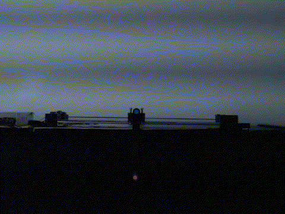

# 비전 기반 1단 도립진자

USB 카메라로 진자와 카트의 위치를 측정하고, Raspberry Pi와 RP2040으로 스윙업부터 균형 유지까지 제어한 프로젝트입니다.

- Raspberry Pi: 영상 처리, 상태 추정, 스윙업·균형 제어, 기록
- RP2040: STEP 펄스, 호밍, 리미트, watchdog, ESTOP
- Camera: Logitech C922, 640×480 MJPEG, 30 FPS

## 실물 성공 기록

| 항목 | 측정값 |
| --- | ---: |
| 연속 ±5° 유지 | 15.029995731초 |
| 안정 구간 표본 | 1,504개 |
| 안정 구간 각도 RMS | 0.444° |
| 안정 구간 최대 절대 각도 | 3.678° |
| 카트 이동 범위 | 215.1~324.075 mm |
| 마커 검출률 | 100% |
| 영상 누락 | 0프레임 |
| 종료 상태 | IDLE, 모터 속도 0 |

## 동작 흐름

~~~mermaid
flowchart LR
    A["Camera frame"] --> B["HSV marker tracking"]
    B --> C["상태 추정 θ, ω, x, v"]
    C --> D{"제어 모드"}
    D -->|하향 구간| E["에너지 스윙업"]
    D -->|수직 부근| F["위치/각도 PID"]
    E --> G["호스트 안전 제한"]
    F --> G
    G --> H["USB serial"]
    H --> I["RP2040 watchdog·limit·PWM"]
    I --> J["Stepper motor"]
    J -. "다음 카메라 프레임" .-> A
~~~

Raspberry Pi의 출력이 바로 STEP 신호가 되지는 않습니다. 호스트에서 속도·가속도·제동거리를 제한한 뒤 RP2040이 같은 명령을 다시 검사합니다.

## OpenCV 처리 과정

실제 성공 영상의 216번 프레임에 실험 당시 캘리브레이션 값을 적용했습니다.

1. BGR 원본 프레임을 HSV로 변환
2. pivot과 tip 색 범위를 `cv2.inRange`로 분리
3. 3×3 `MORPH_OPEN`과 `MORPH_CLOSE`로 작은 노이즈 제거
4. contour 면적·형상·연속성을 평가해 중심점 선택
5. 중심점으로 카트 위치와 진자 각도 계산
6. timestamp 차분과 12 Hz 저역통과 필터로 속도 계산

비슷한 후보가 두 개 이상이거나 마커가 사라지면 이전 좌표를 재사용하지 않고 해당 프레임을 무효 처리합니다.

[비전 처리 과정과 실제 중간 이미지 자세히 보기](docs/vision_pipeline.md)

## 제어 알고리즘

~~~mermaid
flowchart TD
    A["θ, ω, x, v"] --> B{"Swing-up / Balance"}
    B -->|Swing-up| C["에너지 오차 + 중앙복귀 PD"]
    C --> D{"포착 각도·각속도·속도 여유"}
    D -->|통과| E["Balance로 전환"]
    D -->|계속| F["속도 적분"]
    B -->|Balance| G["위치 PID → 목표 각도"]
    E --> G
    G --> H["각도 PID → 가속도"]
    H --> F
    F --> I["속도·가속도·레일 제한"]
~~~

스윙업은 진자의 에너지 오차를 이용해 카트를 가속하고, 레일 중앙을 유지하기 위한 PD 항을 함께 사용합니다. 수직 부근에서 각도·각속도와 제어 여유가 모두 조건 안에 들어오면 현재 카트 속도를 유지한 채 balance PID로 전환합니다.

균형 제어는 두 개의 루프로 구성됩니다.

- 외부 루프: 카트 위치 오차 → 작은 목표 진자 각도
- 내부 루프: 진자 각도 오차 → 카트 가속도

[스윙업 식, PID 구조와 포착 조건 자세히 보기](docs/control_algorithm.md)

## 안전 구조

### Raspberry Pi

~~~text
DISCONNECTED → UNHOMED → CALIBRATION_REQUIRED → IDLE → ARMED → RUNNING
~~~

serial, watchdog, 호밍, 현재 영상 추적과 전원 상태가 모두 정상이어야 `RUNNING`으로 들어갑니다. 오래된 상태, 마커 손실, 레일 경계 접근 또는 전원 이상은 정지 조건입니다.

### RP2040

- 부팅 직후 ESTOP latch와 ENA 비활성
- 400 ms heartbeat watchdog
- 최대 속도와 2000 mm/s² 가감속 제한
- 양쪽 소프트 리미트와 NC 물리 리미트
- 호밍 전 일반 속도 명령 거부
- 방향 전환 전 PWM 정지
- 비차단 호밍 상태기

## 하드웨어

| 부품 | 역할 |
| --- | --- |
| Raspberry Pi 5 | 비전, 상태 추정, 제어, 대시보드, 기록 |
| Logitech C922 | 640×480 MJPEG 30 FPS |
| Waveshare RP2040 Zero | STEP/DIR/ENA, 호밍, watchdog, 리미트 |
| NEMA23 + stepper driver | 카트 구동 |
| NC 리미트 스위치 2개 | 레일 양 끝 검출 |
| 색상 마커 | 진자 tip과 pivot 추적 |

RP2040 핀은 ENA 6, STEP 7, DIR 8, LEFT LIMIT 9, RIGHT LIMIT 10을 사용합니다.

## 설치와 실행

Python 3.11 이상을 권장합니다.

~~~bash
sudo apt update
sudo apt install -y python3-venv libgl1 libglib2.0-0

python3 -m venv .venv
source .venv/bin/activate
python -m pip install --upgrade pip
python -m pip install -r requirements.txt
~~~

처음에는 모터를 막고 영상과 대시보드부터 확인합니다.

~~~yaml
hardware:
  enabled: false

camera:
  enabled: true
  index: 0
  fourcc: MJPG
  width: 640
  height: 480
  fps: 30

controller:
  swing_up:
    enabled: false
  gains:
    kp_angle: 0.0
    ki_angle: 0.0
    kd_angle: 0.0
    kp_position: 0.0
    ki_position: 0.0
    kd_position: 0.0
~~~

실행:

~~~bash
python -m raspberry_pi.main --config config.local.yaml
~~~

대시보드 기본 주소는 `http://127.0.0.1:8000`입니다.

## 저장소 구조

~~~text
firmware/main.ino               RP2040 펌웨어
raspberry_pi/color_tracker.py   HSV 마커 검출
raspberry_pi/state_estimator.py θ, ω, x, v 계산
raspberry_pi/pid_controller.py  스윙업과 balance PID
raspberry_pi/safety.py          호스트 안전 상태기
raspberry_pi/runtime.py         카메라·제어·기록 스레드
dashboard/                      운영 대시보드
calibration/profiles/           장비별 보정값
experiments/logs/               실험 로그
experiments/videos/             실험 영상
tests/                          회귀 테스트
~~~

## 문서

| 문서 | 내용 |
| --- | --- |
| [비전 처리 파이프라인](docs/vision_pipeline.md) | HSV 범위, morphology, contour 점수, 좌표와 상태 계산 |
| [스윙업과 균형 제어](docs/control_algorithm.md) | 에너지식, PID, 포착, 지연 보정과 안전 제한 |
| [전체 구조](docs/architecture.md) | 실행 스레드와 Raspberry Pi/RP2040 역할 |
| [하드웨어 검증](docs/hardware_validation.md) | 전원, 리미트, 방향, 호밍과 실물 시험 순서 |
| [스윙업 검증](docs/swing_up_validation.md) | 단계별 스윙업 시운전 |
| [펌웨어 분석](docs/firmware_analysis.md) | RP2040 PWM, watchdog과 호밍 구현 |

## 테스트

~~~bash
python -m pytest
~~~

회귀 테스트는 카메라·추적·상태 추정·제어·안전 상태기와 웹 인터페이스를 대상으로 합니다. 실제 모터 방향, 리미트 극성, 제동거리, 기계 마찰과 전원 품질은 별도의 실물 확인이 필요합니다.
